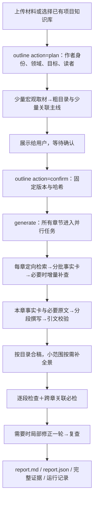

# DSH 材料与知识组装插件

独立 DSH/Cordis 插件：导入材料、同步项目知识库，按规则生成可审阅的解决方案正文。当前输出 Markdown/JSON；HTML 编辑、架构图绘制、PPTX/PDF 导出尚未实现，不依赖旧插件或 HTML Anything。

**当前源码为 0.4.0，第一批流程改造已实现；本轮未打包、部署或运行真实模型。** 最近交付的安装包为 0.3.0，本机已安装版本不会随源码更新。实际验证见 [测试记录](docs/test-record.md)，遗留任务见 [待办](docs/backlog.md)。

## 1. 项目、规则和插件在哪里

| 对象 | 位置 |
|---|---|
| GitHub | <https://github.com/z460046000-ops/WLYD_content> |
| 开发目录 | `/Users/zhangzhengao/Documents/ChatGPT/WLYDContant/dsh-material-knowledge-assembly` |
| npm 包名 | `@wlyd/dsh-material-knowledge-assembly` |
| Cordis 组件 / 工具前缀 | `wlyd-material-knowledge-assembly` / `wlyd_assembly_*` |
| DSH 插件页名称 | `material-knowledge-assembly` |
| 日常安装目录 | `~/.dsh/profiles/web/node_modules/@wlyd/dsh-material-knowledge-assembly/` |
| 历史安装包 / 校验 | `releases/` / `releases/SHA256SUMS` |
| 运行产物 | **当前 DSH 会话工作区**的 `artifacts/material-knowledge-assembly/runs/<runId>/` |

例如在 `gen` 工作区测试，产物位于 `/Users/zhangzhengao/Desktop/gen/artifacts/material-knowledge-assembly/runs/`。开发、安装和运行产物是三个位置；复用导入 runId 时须使用同一工作区。

```text
src/
├── index.js         五个官方工具和参数
├── workflow.js      材料导入、状态查询、已确认方案生成与报告落盘
├── planning.js      宏观取材、粗大纲、确认版本和生成前校验
├── plan-model.js    主线归一化、模式选择和近义标题校验
├── store.js         运行路径、导入材料读取与内容摘要核对
├── convert.js       格式识别和文字转换
├── platform.js      后端账号、项目、知识库、上传和检索适配
├── retrieval.js     授权范围、查询、去重、按章选择与完整证据登记
├── context.js       阶段规则投影、请求记录、分批、事实与引文选段
├── facts.js         分批提取事实卡，资源超限只拆失败批
├── generation.js    所有章节并行进入取证、事实卡和分段撰写，按目录合稿
├── panorama.js      小范围单轮全景补充，保留原稿
├── review.js        必经逐段与跨章关联检查、局部修正和复查
├── content.js       引文、数字、目录、能力边界检查及 Markdown 输出
├── model.js         模型路由、低思考适配、输出预算、超时和流式指标
├── scheduler.js     共享模型/检索额度、排队与取消
├── rules.js         加载模板、章节角色与规则指纹
└── schema.js        DSH 工具标准 JSON Schema
rules/
├── global.json      所有方案共用的取材、组稿与合稿必检规则（0.7.0）
├── style.json       短标题、短语概括、短句说明等共用写法
├── templates/       各方案类型的默认目录，目前提供 presales-solution
└── chapters/        按角色定义 extractQuestions / write / validate / missing
```

模板定义目录，章节角色定义取材和写法，全局规则定义共同纪律；产品事实来自用户材料和授权知识库。goodcase 只学习方法，不作为本次客户、产品能力、数字或奖项证据。`extractQuestions` 是重点线索，不是白名单。全景规则的学习依据见 [全景学习记录](docs/panorama-rule-evidence.md)。

## 2. 产品流程与调度



### 轻量规划和确认

- 作者身份与读者分开：`author_identity` 如营销顾问、人力资源顾问；`domain` 为领域，`objective` 为目标，`audience` 为读者。
- 规划只选最多四条代表性证据，长证据先分批提取；粗大纲每章一句目的和简短检索方向，提示模型只挑最多三条主线，不穷举全部功能或设计详细全景。
- `outline action=plan` 保存 `outline-plan.json`，返回 `planId`、`planSha256`、粗目录、候选主线和复核项。失败直接报告，不自动降级后偷偷进入正文。
- 展示目录与主线，收到用户明确确认后才调用 `action=confirm`。程序校验版本和规则哈希；**用户确认意图由 DSH 对话负责，布尔字段不是独立身份审批证明**。
- `generate` 必须带已确认的 `plan_id` 与 `plan_sha256`。项目、材料运行、目录、写作身份、目标、读者或规则版本不一致时要求重新规划确认。正文不再调用详细全局规划。
- 目录修改后重新 `action=plan` 创建版本，再展示和确认。尚无专用审批界面或多人并发编辑协议。

### 按章取证和撰写

- 知识库只查询当前配置账号可见、绑定项目且解析完成的文档。统一检索优先 `POST /api/v1/knowledge-bases/{id}/retrieval/query`，只请求 hybrid、`top_k=12`、`include_citations=true`，显式限定 `knowledge_ids`；空文档列表不查询全库。
- 只有新路由 404/405 才回退旧 `/hybrid-search`，401/403 不绕过权限。来源状态、traceId、查询用途及章 key 保留在检索记录中。Wiki、图谱、后台父块/邻块回读尚未接入。
- 正文只做章节查询，不再做全局发现。每章选择最多八条远程命中及必要主线锚点；有知识库命中时不再附加一整批本地副本。无命中时可按词面和邻段选择本地材料，不能保证语义召回完整。
- 原始本地材料和所有已召回片段完整存档。选定长证据按约 2400 字符窗口、160 字符重叠分批，每批约 6000 字符；所有窗口均处理到末尾，**这是批次组织单位，不是全局 token 限额**。模型上下文仍由 DSH/提供方约束。
- 每批只提取本章相关事实卡，附短的逐字引文，保留条件、否定和边界。每批成功即保存部分结果；本章最终保存 `extraction.json`。
- 具体不足最多补查一轮，按内容去重，只提取新增证据，合并已有事实卡。记录补查问题、新证据与新事实数量；这些数量不能自动证明缺失已解决。
- 撰写按事实卡分批，一次通常最多四条事实，不再重复携带原文全集、全量共享计划和全套规则。提供原文引文及其附近条件，原文选段不伪装成整篇材料；校验始终回查完整来源。
- 超时、输入超限、输出耗尽只拆失败批，递归最多两层；无法再拆则明确失败，不反复原样重试。格式/临时错误最多一次局部重试。单章失败保留其他章节；批次拆分失败时部分事实和原稿文件仍在。

所有章节同时进入任务；每章取证就绪就写，不等待其他章全部提取完。模型请求共享默认八个名额，可配置 1–12；后台查询共享四个名额。超过八章时模型请求会排队，“全章并行任务”不等于无限同时调用模型。取消向活动请求传递信号并停止后续工作；没有跨进程自动恢复。

### 前后关联怎么守住

粗大纲阶段固定少量 **产品能力→场景→问题→趋势** 主线和稳定编号，各章只携带相关部分并独立取证。展示顺序按确认目录。典型问题无客户证据时保持假设，不能反推成客户已经发生的事实。

合稿**必须**执行以下检查：

1. 重点问题是否有后文方案回应。
2. 产品能力是否有证据，试点、规划、第三方和客户已有能力是否被升级。
3. 重点场景是否能在业务/产品全景找到对应位置。
4. 政策趋势是否关联实际建设内容。
5. 是否有矛盾、遗漏、无关堆砌或孤立内容。

每段都进入分批检查；业务问题、趋势和场景再分别寻找跨章候选，包含没有共享编号的新内容。跨章候选按共享编号和词面排序，并保留短索引导航，**有限候选匹配不能证明语义穷尽**。模型需返回每项结果及理由，缺项、超时、输出截断不能算通过。资源限制导致关联分组再拆时，联合语义仍标未完成。

具体问题最多进行一轮局部修正：至多三个检查组，每组最多两段，保持原段落 ID，禁止删除、越界修改、编造来源或将候选提升为事实。原 `chapter.json` 保留，修后稿另存 `assembly-reviewed.json`；有实际修改后重新检查所有组。未解决项保留待审，不循环重跑整篇。

`assemblyReview.status` 表示检查是否完成，`assemblyReview.passed` 表示本轮模型检查是否通过；缺章时整体不能通过。模型判断仍可能出错，报告最终保持 `needs_human_review`。更完整的“完整待审/部分成稿”状态体验列入第二批。

### 模型和写作规则

- 固定本次运行的实际会话 provider/model，避免中途切换混入另一条路由。
- 用 DSH `resolveModelInfo` 查询模型支持的强度，优先选择声明支持的 `low`、`minimal`、`off` 或 `none`；不继承会话 high/max。未提供查询或不支持低档时记录实际限制，使用提供方默认行为，不能宣称已低思考生效。
- 输出预算：plan 4096、extract 3072、write 6144、复核 3072、局部修正 4096；已知适配器默认输出额度更小时取较小值。这些是请求预算，网关效果待实测。
- 记录输入 UTF-16 字符、UTF-8 字节、证据量、首思考/首正文、排队/执行时间、请求预算、结束原因、正文/思考字符量及可得 usage；字符数不是 token，缺 usage 不估算账单。
- 默认排队 30 分钟，获取名额后执行 10 分钟；延长超时只增加等待窗口，不代表提速。
- 共用写法为短标题、短语概括及短句解释；保持业务动作、因果、适用条件和引用。业务现状/需求挑战、PEST/管理业务技术各二选一；业务正文 15–30%、解决方案及子章 40–60% 是软目标，不为凑比例编造。
- 两类全景输出文字内容，按本章材料动态组织。小范围保留最多一轮追加；正文与证据合计超过 12000 字符时跳过该独立追加，改由分组检查及局部修正发现衔接问题，不将跳过当作补充完成。

## 3. 官方工具及分阶段提示词

| 工具 | 输入与用途 |
|---|---|
| `wlyd_assembly_projects` | 列出配置账号可见项目 |
| `wlyd_assembly_ingest` | `files` 或可信 `attachment_refs`，可选项目/库；转换、同步或复用已有文件 |
| `wlyd_assembly_outline` | `action=preview` 仅预览模板；`plan` 接项目/材料、目录、作者身份与目标；`confirm` 接 `plan_id`、`plan_sha256`、`confirmed=true` |
| `wlyd_assembly_generate` | **必需**已确认的 `plan_id`、`plan_sha256`；其他参数若提供须与确认版本一致 |
| `wlyd_assembly_status` | `run_id`，查看导入、大纲规划确认或生成进度；生成/规划状态只读 |

**规划阶段：**

> 只用 wlyd_assembly_*。使用现有项目知识库和可复用导入材料，以营销顾问身份，为业务负责人编制 CallWan 售前方案。调用 outline action=plan，展示粗目录、每章目的和产品能力→场景→问题主线，等我确认后再继续。不要生成正文，也不要重复上传材料。

**确认后生成：**

> 我确认刚才展示的大纲和主线。请确认该 planId 和 planSha256，然后只启动一次生成。完成后告诉我缺章、合稿关联检查结果、耗时与产物路径；失败不要自动整篇重跑。

**调整目录：**

> 加入“实施与服务”，绑定 delivery-service，放在技术平台之后；重新规划并展示给我确认。

自定义 `roleId=custom` 需说明 `goal`、`audience`、`questions`、`evidenceScope`、`acceptance`。目前没有独立的单章扩写、重写、恢复工具。

## 4. 运行产物

```text
artifacts/material-knowledge-assembly/runs/<runId>/
├── run.json                  导入、规划或生成状态及请求指标
├── materials/*.md            导入运行：完整转换材料
├── outline-plan.json         规划运行：粗大纲、身份目标、主线、规则与版本哈希
├── overview-facts.json       规划运行：代表证据事实卡
├── evidence.json             全部已登记原文及检索覆盖
├── retrieval.json            查询用途、章节归属、来源状态、traceId
├── plan.json                 生成复用的确认主线，附规划 ID 与哈希
├── chapters/<key>/
│   ├── retrieval.json        最近一轮选择与本章查询日志
│   ├── extraction-partial.json / supplement-partial.json
│   ├── extraction.json       合并后的事实卡、来源、批次与待审项
│   ├── draft-*.json          各批原始撰写/修正输出
│   ├── draft.json / chapter.json / error.json
│   └── enriched.json         有有效全景追加时另存
├── panorama-enrichment.json  实际执行全景追加时保存
├── consistency-review.json  五项必检逐组结果、未完成项、修正记录
├── assembly-reviewed.json    局部修正后的合稿；原章节文件保留
└── report.md / report.json   供用户审阅的最终正文与结构化结果
```

导入、大纲规划和生成各有自己的 runId。生成用 `sourceRunId` 关联导入，通过 `confirmedPlan` 关联规划。`loadedRules`、`ruleFingerprint` 和规划 SHA-256 可追溯版本。已有导入材料摘要发生变化时要求重新导入。

## 5. 安装与配置

Node.js 22+、DSH 和内容中台账号为前提。**0.4.0 本轮只交源码**，后续打包部署时执行：

```bash
npm ci
npm run check
npm test
npm pack --pack-destination releases
shasum -a 256 releases/wlyd-dsh-material-knowledge-assembly-0.4.0.tgz
dsh plugin --profile web add /absolute/path/to/wlyd-dsh-material-knowledge-assembly-0.4.0.tgz
```

这些是后续操作命令，不代表本轮已生成安装包。安装后重启对应 DSH，在插件页核对版本与组件“运行中”。

配置优先级：插件 config → 环境变量 → `$DSH_HOME/.env`。

| config | 环境变量 |
|---|---|
| `baseUrl` | `WLYD_PLATFORM_BASE_URL` |
| `email` | `WLYD_PLATFORM_EMAIL` |
| `password` | `WLYD_PLATFORM_PASSWORD` |
| `tenantId` | `WLYD_PLATFORM_TENANT_ID` |

凭证不得提交仓库。当前配置账号与 DSH 真实用户的映射未正式打通，`platformUserId=null`；不能声称按真实平台用户归属上传。

调度设置从环境变量或 `$DSH_HOME/.env` 读取，进程环境优先，修改后重启：

| 环境变量 | 默认 / 范围 |
|---|---|
| `WLYD_ASSEMBLY_CONCURRENCY` | 模型并发 8，可设 1–12，检索独立四路 |
| `WLYD_ASSEMBLY_QUEUE_TIMEOUT_MS` | 1800000，可设 60000–1800000 |
| `WLYD_ASSEMBLY_STAGE_TIMEOUT_MS` | 按阶段 JSON，默认 600000，可设 60000–1800000 |

阶段名：`plan`、`extract`、`write`、`panorama-enrichment`、`consistency-review`、`relationship-repair`；`default` 控制其余阶段。例：`WLYD_ASSEMBLY_STAGE_TIMEOUT_MS='{"default":600000,"plan":300000}'`。

## 6. 仍未打通与验收边界

- 第二批：单独补失败章/重启恢复、跨会话重复任务防护、完整待审与部分成稿的状态体验；第一批没有实现这些入口。
- 尚未实测本次新流程的真实成稿质量、模型低思考是否被网关执行、输入下降和耗时收益；不承诺固定提速比例。本轮没有真实生成、打包或部署。
- 知识库关联候选和本地词面选段可能漏材料；原文回读、Wiki/图谱和公开检索未接，缺少来源的政策不能冒充检索结果。
- UTF-8 文本、Markdown、DOCX、文字 PDF、PPTX、XLSX、ZIP 支持文字提取；不保证图表、图片文字、版式完整。图片/扫描件 OCR、DMG、旧 Office、音视频、链接抓取未接。
- 单批 100 文件、单文件 500 MB；ZIP 最多 1000 项/共 1 GB。入口限额不证明任意格式 500 MB 全链路可用，真实大文件链路待验收。
- 导入上传的是转换后 Markdown，非原始 Office/PDF。附件必须匹配本会话用户真实上传的 ID、文件名和字节数。
- 本地确认记录不能替代平台用户权限、多用户审批、知识文档不可变版本与乐观锁。最终正文仍须人工确认产品能力、客户事实、政策日期、语义与对外措辞。
- HTML 编辑、架构图绘制、PPTX/PDF、正式 CallWan 发布适配均待后续。

开发验证和历史实测见 [docs/test-record.md](docs/test-record.md)，详细调度见 [docs/architecture.md](docs/architecture.md)。自动化通过不等于真实模型或业务验收通过。
