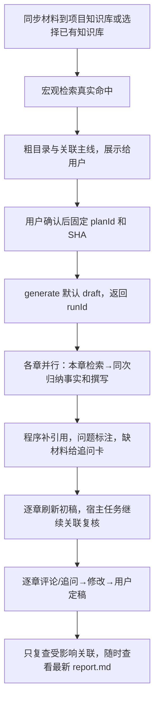

# DSH 材料与知识组装插件

独立 DSH/Cordis 插件：导入材料、同步项目知识库，按规则生成可审阅的解决方案正文。当前输出 Markdown/JSON；HTML 编辑、架构图绘制、PPTX/PDF 导出尚未实现，不依赖旧插件或 HTML Anything。

**当前源码为 0.9.0：合并规划、合并章内提写、精简查询、初稿先交后复核。知识库取材、大纲确认和前后关联检查继续保留。** 本轮按用户要求只交付代码和安装包，**没有安装或重启 DSH**。3081 上次安装记录为 0.8.0；0.9.0 的真实模型质量与耗时尚未实测。安装状态、验证边界见 [测试记录](docs/test-record.md)，后续任务见 [待办](docs/backlog.md)。

全局规则已更新到 **0.11.0**，旧 `planId` 的规则指纹不再匹配：以后安装 0.9.0 后重新 `plan → confirm → generate`，可以复用原导入材料，不必重复上传。

## 1. 项目、规则和插件在哪里

| 对象 | 位置 |
|---|---|
| GitHub | <https://github.com/z460046000-ops/WLYD_content> |
| 开发目录 | `/Users/zhangzhengao/Documents/ChatGPT/WLYDContant/dsh-material-knowledge-assembly` |
| npm 包名 | `@wlyd/dsh-material-knowledge-assembly` |
| Cordis 组件 / 工具前缀 | `wlyd-material-knowledge-assembly` / `wlyd_assembly_*` |
| DSH 插件页名称 | `material-knowledge-assembly` |
| 日常安装目录 | `~/.dsh/profiles/web/node_modules/@wlyd/dsh-material-knowledge-assembly/` |
| 本机测试环境 | `http://127.0.0.1:3081/`，profile 为 `wlyd-assembly-021-browser`（历史名称）；上次安装0.8.0，本轮未更改 |
| 最新安装包 | `releases/wlyd-dsh-material-knowledge-assembly-0.9.0.tgz`；SHA-256 见 `releases/SHA256SUMS`，尚未安装 |
| 历史安装包 / 校验 | `releases/` / `releases/SHA256SUMS` |
| 运行产物 | **当前 DSH 会话工作区**的 `artifacts/material-knowledge-assembly/runs/<runId>/` |

例如在 `gen` 工作区测试，产物位于 `/Users/zhangzhengao/Desktop/gen/artifacts/material-knowledge-assembly/runs/`。开发、安装和运行产物是三个位置；复用导入 runId 时须使用同一工作区。

```text
src/
├── index.js         七个官方工具和参数
├── tasks.js         宿主后台作业、及时返回 runId、查询、取消、重复任务与恢复
├── persistence.js   原子检查点、任务接纳索引、运行占用与历史保留
├── workflow.js      材料导入、状态查询、确认版本校验、恢复准备与报告落盘
├── planning.js      宏观取材、粗大纲、确认版本和生成前校验
├── plan-model.js    主线归一化、模式选择和近义标题校验
├── store.js         运行路径、导入材料读取与内容摘要核对
├── convert.js       格式识别和文字转换
├── platform.js      后端账号、项目、知识库、上传和检索适配
├── retrieval.js     授权范围、查询、去重、按章选择与完整证据登记
├── context.js       请求记录、分批、事实与引文选段
├── prompts.js       按模型阶段与章节角色投影必要提示词
├── facts.js         分批提取事实卡，按输入超限与有效输出耗尽分类处理
├── evidence-policy.js 事实主体、用途、假设身份和章节适配规则
├── generation.js    按质量模式路由；保留 strict 分批撰写和校验
├── draft-generation.js 快速初稿：各章取证、合并提写、逐章交稿、单轮检查
├── combined-writing.js 原文卡分批、同次生成事实与正文、补来源和中断恢复
├── fact-cards.js    稳定事实卡编号、程序补引文、未验证标注与待补卡
├── chapters.js      章节评论、追问、范围修改、版本、定稿与关联复查
├── panorama.js      小范围单轮全景补充，保留原稿
├── review.js        全段与主线合批必检、覆盖记录、局部修正与指纹复用
├── content.js       引文、数字、目录、能力边界检查，正文与内部审核输出
├── model.js         模型路由、低思考适配、输出预算、超时和流式指标
├── scheduler.js     全局与模型路由额度、排队与取消
├── rules.js         加载模板、章节角色与规则指纹
└── schema.js        DSH 工具标准 JSON Schema
rules/
├── global.json      所有方案共用的取材、关联及阶段任务规则（0.11.0）
├── style.json       短标题、短语概括、短句说明等共用写法
├── templates/       各方案类型的默认目录，目前提供 presales-solution
└── chapters/        按角色定义 extractQuestions / write / validate / missing
```

模板定义目录，章节角色定义取材和写法，全局规则定义共同纪律；产品事实来自用户材料和授权知识库。goodcase 只学习方法，不作为本次客户、产品能力、数字或奖项证据。`extractQuestions` 是重点线索，不是白名单。全景规则的学习依据见 [全景学习记录](docs/panorama-rule-evidence.md)。

### 0.9.0 减少模型往返，先交初稿

- **先从知识库取材，再展示粗大纲等用户确认。** 没有当前授权项目知识库的真实命中就不创建 `planId`；本地材料不能冒充知识库命中。每章记录当次查询和命中，规划锚点单列。
- **规划一次完成**：最多四条宏观片段、每条最多1800字符，同次归纳少量事实、粗目录和主线；完整召回原文另存。未返回有效宏观事实时显式保留原文锚点和待审提示，不增加提取调用。
- **默认 `quality_mode=draft`**：每章先查一条，成功但为空或原文明显过少时最多补一条不同查询；失败不扩查。模型同次归纳事实与写正文，短章通常一批，长章按原文窗口处理；不自动追加全景或修正成环。standard 最多修正一次，strict 保留原流程。
- **程序补引文。** 输入原文卡用 `s-*` 编号，模型返回简短事实和正文 `factIds`，程序核对卡与来源、生成兼容 `f-*` 事实卡并补引文。未知编号和不合格表述保留为 `【未验证】`，移除不合法引用；来源定位不代表语义正确。
- **先读初稿，复核继续**：完成一章就刷新 `report.md`，全章产出后标 `reportReady=true`、`draft_reviewing`，同一宿主任务继续一轮五项关联检查。`firstChapterReadyAt`、`draftReadyAt`、`reviewFinishedAt` 分别计时；有待补卡不代表完整正文。复核中的 `chapter action=list` 可读，修改/定稿须等待结束或取消后，防止旧检查覆盖新稿。
- **每章有可见产物。** 正文状态 `draft_unverified`；缺事实或未返回正文时为 `needs_input`，显示原因、具体追问和下一步。正文被截断时保留已完整返回的段落；不会把待补卡说成完整正文。
- **按章修改。** `wlyd_assembly_chapter` 支持评论、追问、解决、修改、定稿和解锁。修改复用该章事实卡与来源，不重新提取全篇；保留版本，其他章节正文、引用和状态不变，合稿按指纹复用未变化的检查。
- **保留三档。** draft 不自动修正；standard 最多修正一次，仍有问题则标注保留；strict 维持原严格生成、过滤和有界修正路径。三种模式都要求已确认大纲。相同规划的不同模式使用不同运行记录。

初稿原文每窗最多2400字符、重叠160字符，每批正文最多8000字符；覆盖选材尾部，不把全集塞进一次请求。续写只带最近八段的短摘要，复核原文按来源去重，避免每段重复整窗引文。单次模型请求执行窗口三分钟，排队另计；不是全流程时限。未新增统一输出token上限，`WLYD_ASSEMBLY_OUTPUT_BUDGETS` 可显式配置。实际提速仍待用户测试，模型/网关不可用、磁盘错误或取消时无法保证正文产出。

### 0.7.0 提示词组织

- `rules/global.json` 的 `sharedRules` 集中维护证据、事实边界、**产品能力→场景→客户问题→相关趋势**关联、能力状态及两类全景职责；`stageContracts` 分别定义规划、提取、撰写、全景补充、合稿检查和局部修正任务。`rules/style.json` 只维护共用表达方式。
- `rules/chapters/*.json` 保留各章节特有的提取重点、写法、校验及材料用途；业务现状/需求挑战、PEST/管理业务技术仍按确认选项二选一。`src/prompts.js` 在每次独立模型请求中只送当前阶段需要的共用规则和本章差异，程序继续读取完整章节规则做校验与事实筛选。
- 固定九章、相同模拟证据与 31 次模拟请求下，序列化请求总量从 135356 降至 102306 个 UTF-16 字符（约降 24.4%），撰写阶段约降 47.2%；证据文本量和调用数相同。该结果只说明请求体缩短，不等于 token、真实耗时或成稿质量收益；详见 [测试记录](docs/test-record.md)。

### 0.6.0 的五项内容调整

| 环节 | 当前处理 |
|---|---|
| 材料用途 | 在原有提取请求中标注主体、用途、主题与事实/假设身份，不新增串行分类调用。原文完整保留，章节通过 `contentPolicy` 选材；内部经营与研发判断不当作客户问题 |
| 规划主线 | 从有据产品能力组织场景、客户问题和相关趋势；典型推演始终保持候选身份，规划控制话术不进入标题和内容目的 |
| 主题组稿 | 合并重复事实及来源，按主题组织写作批次；无效段落进行有界局部修正，其他通过校验的段落保留 |
| 结构完整性 | 有有效段落但尚未写完记为 `partial`；必需或失败章节保留简短占位。仅明确 `required=false` 且没有适合正文的正向事实时可省略，不用缺案例说明填正文 |
| 正文与审核 | `report.md` 放方案正文、依据和真实的部分稿提示；内部事项放 `review.md` / `review.json`，按章归组、程序去重，原始记录仍完整保留在 `report.json` |

未知主体或用途不是已核验事实：在客户问题、趋势中按候选使用；案例和企业介绍要求明确对应用途（`requireKnownPurpose=true`），不能用内部知识库目录或“没有资料”凑章。分类标签不证明材料可对外披露，仍需人工确认。

## 2. 产品流程与调度



### 轻量规划和确认

- 作者身份与读者分开：`author_identity` 如营销顾问、人力资源顾问；`domain` 为领域，`objective` 为目标，`audience` 为读者。
- 规划只选最多四条代表性证据的开头选段，同次归纳宏观事实与粗大纲，每章一句目的和简短检索方向，提示模型只挑最多三条主线；完整知识原文另存，不宣称规划读完全文。
- `outline action=plan` 先检查真实知识库命中，再保存 `outline-plan.json`，返回 `planId`、`planSha256`、命中数、粗目录、候选主线和复核项。没有项目授权、解析完成的文档或有效命中就失败，不自动用本地材料代替。
- 展示目录与主线，收到用户明确确认后才调用 `action=confirm`。程序校验版本和规则哈希；**用户确认意图由 DSH 对话负责，布尔字段不是独立身份审批证明**。
- `generate` 必须带已确认的 `plan_id` 与 `plan_sha256`。项目、材料运行、目录、写作身份、目标、读者或规则版本不一致时要求重新规划确认。正文不再调用详细全局规划。
- 目录修改后重新 `action=plan` 创建版本，再展示和确认。尚无专用审批界面或多人并发编辑协议。

### 按章取证和撰写（以下细节为 strict；draft 差异见上文）

- 知识库只查询当前配置账号可见、绑定项目且解析完成的文档。统一检索优先 `POST /api/v1/knowledge-bases/{id}/retrieval/query`，只请求 hybrid、`top_k=12`、`include_citations=true`，显式限定 `knowledge_ids`；空文档列表不查询全库。
- 只有新路由 404/405 才回退旧 `/hybrid-search`，401/403 不绕过权限。来源状态、traceId、查询用途及章 key 保留在检索记录中。Wiki、图谱、后台父块/邻块回读尚未接入。
- 正文只做章节查询，不再做全局发现。每章选择最多八条远程命中及必要主线锚点；有知识库命中时不再附加一整批本地副本。零命中时只用已确认规划的知识库锚点支撑待确认推演，留存本章检索记录并标为部分完成；不能保证语义召回完整。
- 原始本地材料和所有已召回片段完整存档。选定长证据按约 2400 字符窗口、160 字符重叠分批，每批约 6000 字符；所有窗口均处理到末尾，**这是批次组织单位，不是全局 token 限额**。模型上下文仍由 DSH/提供方约束。
- 每批只提取本章相关事实卡，附短的逐字引文，保留条件、否定和边界；同次请求标注 `subject`、`purpose`、`topic`、`supportMode`。每批成功即保存部分结果；本章最终保存 `extraction.json`，用途不适配的事实仍留在提取与审核记录中。
- 具体不足最多补查一轮，按内容去重，只提取新增证据，合并已有事实卡。记录补查问题、新证据与新事实数量；这些数量不能自动证明缺失已解决。
- 撰写按章节任务与模型元数据组织事实卡批次，重点章和较小路由默认预算使用更小批次，不再重复携带原文全集、全量共享计划和全套规则。提供原文引文及其附近条件，原文选段不伪装成整篇材料；校验始终回查完整来源。
- 输入超限只拆失败批，最多两层；有可见输出的输出耗尽可减小任务。零正文输出耗尽、429、排队超时、执行超时分别记录，不通过拆材料放大请求。429 统一最多退避两次；临时格式错误至多一次局部重试。写作批失败或某段修不合格时，保留其他已通过段落，将本章标为部分完成；检查点和错误文件单独留存。

所有章节同时进入任务；每章取证就绪就写，不等待其他章全部提取完。模型请求共享默认八个名额，可配置 1–12，并可对具体模型路由设置更小额度；后台查询共享四个名额。路由先取额度，饱和路由不会占住其他路由的全局额度。超过额度会排队，“全章并行任务”不等于无限同时调用模型。

`generate` 完成校验和作业接纳后返回 `runId`，正文由 DSH 宿主作业继续执行；后续用 `status` 查询和 `cancel` 取消。作业只在 DSH 进程与所属会话生命周期内运行；关电脑或结束进程会停止，不能当云端持久队列。重启后显式 `mode=resume`，校验材料、规则、目录、固定模型与当前授权范围再接续；保留可验证的已完成章节。相同输入默认复用已有任务，`mode=regenerate` 明确创建新运行。旧版没有新版检查点的任务不可直接恢复。

恢复以整章提取、整章成稿为单位：`partial` 章可复用有效提取，但本章写作会重写，并非只恢复失败批；其他完成章保留。全景补充和关联检查也按输入指纹复用，正文、证据或规则变化则重新核对。接纳候选和历史锁保留供排查；孤儿接纳记录会明确报错，不无限冒充排队。

### 守住前后关联的内容（draft 只检查与标注；以下修正规则用于 strict）

粗大纲阶段固定少量 **产品能力→场景→问题→趋势** 主线和稳定编号，各章只携带相关部分并独立取证。展示顺序按确认目录。典型问题无客户证据时保持假设，不能反推成客户已经发生的事实。

合稿**必须**执行以下检查：

1. 重点问题是否有后文方案回应。
2. 产品能力是否有证据，试点、规划、第三方和客户已有能力是否被升级。
3. 重点场景是否能在业务/产品全景找到对应位置。
4. 政策趋势是否关联实际建设内容。
5. 是否有矛盾、遗漏、无关堆砌或孤立内容。

每段都进入章节批次检查；业务问题、趋势和场景按相关章节与主线合批，保留全部显式对应和无共享编号的候选。章节批和关系批均有字符、段落数量边界，关系组最多 12 段、四条主线，导航最多八条；单段过长仍保留原文，不能假称已裁到固定输入上限。跨章候选按共享编号和词面排序，**有限候选匹配不能证明语义穷尽**。状态/归属差异先由程序标记，语义矛盾仍交章节审核；检查覆盖写入 `coverage`。模型需返回每项结果及理由，缺项、超时、输出截断不能算通过。资源限制导致关联分组再拆时，联合语义仍标未完成。

具体问题最多进行一轮局部修正：至多三个检查组，每组最多两段，保持原段落 ID，禁止删除、越界修改、编造来源或将候选提升为事实。原 `chapter.json` 保留，修后稿另存 `assembly-reviewed.json`。修正后重新组织全部必要检查，按正文、主线、规则和证据指纹复用未变化的结果；只调用受影响或新增批次。无变化修正也记录缓存，未解决项保留待审，不循环重跑整篇。

全景追加和合稿替换继续执行与初稿相同的本章事实引用及用途边界，缓存结果也要检查。拒绝的修改保留原有效段落并记入内部审核，避免后置修正重新带入内部说明、候选企业背书或越界引文。

`assemblyReview.status` 表示检查是否完成，`assemblyReview.passed` 表示本轮模型检查是否通过；缺章或部分章时整体不能通过。默认 draft/standard 的 `draft_ready` 表示每章已有正文或材料卡；章状态为 `draft_unverified` / `needs_input`，并不代表全部正文已写完。strict 的生成状态为 `needs_human_review` 时表示所需正文节点完整、仍需人工审阅；`partial_draft` 表示存在缺章或 `partial` 章，`failed` 表示本轮未成功成稿，取消或进程中断另行记录。显式省略的可选章记为 `omitted`，不冒充已写完，也不算必需缺章。完整待审不代表模型审核通过，必须同时查看 `assemblyReview` 与覆盖记录。

### 模型和写作规则

- 固定本次运行的实际会话 provider/model，避免中途切换混入另一条路由。
- 用 DSH `resolveModelInfo` 查询模型支持的强度，优先选择声明支持的 `low`、`minimal`、`off` 或 `none`；不继承会话 high/max。未提供查询或不支持低档时记录实际限制，使用提供方默认行为，不能宣称已低思考生效。
- 默认不再设置插件硬编码 `maxTokens`，使用路由默认输出策略；`defaultMaxTokens` 只描述默认值，不能当成能力上限。可用 `WLYD_ASSEMBLY_OUTPUT_BUDGETS` 显式配置阶段或具体路由预算。思考 token 是否计入输出由提供方决定，需看真实 usage/finishReason，不能把字符数当 token。
- 429 最多退避两次，优先尊重提供方等待时间，加入短抖动；`Retry-After` 超过 60 秒立即停止重试并保留失败原因。等待时释放模型额度，用户取消可终止等待；执行/排队超时不按 429 重试。
- 记录输入 UTF-16 字符、UTF-8 字节、证据量、首思考/首正文、排队/执行时间、请求预算、结束原因、正文/思考字符量及可得 usage；字符数不是 token，缺 usage 不估算账单。
- 默认排队 30 分钟，获取名额后执行 10 分钟；延长超时只增加等待窗口，不代表提速。
- 共用写法为短标题、短语概括及短句解释；保持业务动作、因果、适用条件和引用。业务现状/需求挑战、PEST/管理业务技术各二选一；业务正文 15–30%、解决方案及子章 40–60% 是软目标，不为凑比例编造。
- 两类全景输出文字内容，按本章材料动态组织。小范围保留最多一轮追加；正文与证据合计超过 12000 字符时跳过该独立追加，改由分组检查及局部修正发现衔接问题，不将跳过当作补充完成。

## 3. 官方工具及分阶段提示词

| 工具 | 输入与用途 |
|---|---|
| `wlyd_assembly_projects` | 列出配置账号可见项目 |
| `wlyd_assembly_ingest` | `files` 或可信 `attachment_refs`，可选项目/库；转换、同步或复用已有文件 |
| `wlyd_assembly_outline` | `action=preview` 仅预览模板；`plan` 接项目/材料、目录、作者身份与目标；`confirm` 接 `plan_id`、`plan_sha256`、`confirmed=true` |
| `wlyd_assembly_generate` | `mode=start` 默认接纳后台作业，必需已确认的 `plan_id`、`plan_sha256`；`mode=resume` 带 `run_id` 接续，`mode=regenerate` 明确新建；返回 runId |
| `wlyd_assembly_status` | `run_id`，查看导入、大纲规划确认或后台生成进度；区分 `partial` / `omitted`，返回 `reviewPath` / `reviewJsonPath`；生成/规划状态只读 |
| `wlyd_assembly_chapter` | `list/comment/question/resolve/revise/approve/reopen`，生成后按章迭代；修改、定稿、解锁传最新 `expected_version` |
| `wlyd_assembly_cancel` | `run_id`，按宿主会话授权取消活动作业；保留已完成文件 |

**规划阶段：**

> 只用 wlyd_assembly_*。使用现有项目知识库和可复用导入材料，以营销顾问身份，为业务负责人编制 CallWan 售前方案。调用 outline action=plan，展示粗目录、每章目的和产品能力→场景→问题主线，等我确认后再继续。不要生成正文，也不要重复上传材料。

**确认后生成：**

> 我确认刚才展示的大纲和主线。使用真实 planId、planSha256 调用 outline action=confirm，再以 mode=start 提交一次 generate。返回 runId 后停下，不循环等待，不重复创建；没有真实确认 ID 或哈希就报告异常。

**查询与接续：**

> 只用 status 查询刚才的 runId，汇总完成、失败和待处理节点、关联检查与覆盖、产物路径，不触发生成。若任务已中断或部分失败，先告诉我具体原因。

> 接续这个 runId：使用 generate mode=resume 和 run_id。复用可验证的完成内容，只处理未完成部分。材料、规则、目录、模型或权限变化时明确说明拒绝原因，不静默新建整篇。

**取消：**

> 对这个 runId 调用 wlyd_assembly_cancel，随后用 status 确认取消结果，保留已有成稿。

**调整目录：**

> 加入“实施与服务”，绑定 delivery-service，放在技术平台之后；重新规划并展示给我确认。

自定义 `roleId=custom` 需说明 `goal`、`audience`、`questions`、`evidenceScope`、`acceptance`。目前可恢复失败或中断任务，尚无任意指定成功章的对话扩写/重写入口。

### 只测试两类全景内容

在同一工作区选择已有项目或导入材料，新建会话后发送：

> 请只使用 wlyd_assembly_* 工具，基于我选择的项目知识库和已有材料测试全景内容。作者身份是售前解决方案顾问，读者是客户业务负责人。调用 `wlyd_assembly_outline` 的 `action=plan` 时，必须显式传入 `outline=[{"key":"business-architecture","title":"业务架构全景","roleId":"business-architecture","required":true},{"key":"product-architecture","title":"产品功能架构全景","roleId":"product-architecture","required":true},{"key":"scenarios","title":"典型业务场景方案","roleId":"scenario-solution","required":true}]`，不要只描述章节或使用默认目录。展示粗大纲、问题与产品能力及场景的对应主线，等待我确认。

看过大纲后回复“我确认这个大纲和主线，请确认该版本并提交一次生成”。取得 runId 后用 status 查询，勿重复 generate。升级改变规则指纹，旧规划必须重建；已有导入可复用，但须使用原工作区。

检查业务全景是否讲清角色与业务流程、产品全景是否讲清功能支撑及边界、后文重点场景能否在两图内容中定位，以及已具备/规划/第三方能力是否区分。成稿看 report.md，内部问题看 review.md，逐章检索过程看 chapters/<key>/retrieval.json。partial_draft 或必需章未完成不算完整通过。当前验收的是文字底稿，尚无实际架构图绘制。

### 章节迭代提示词

> 对这个生成 runId 调用 `wlyd_assembly_chapter action=list`。只修改“典型业务场景”章节：先记录评论“减少概念说明，突出业务动作与价值”，再用返回的 chapter_key、最新 expected_version 调用 revise。其他章节保持原样，给我本章新版本和 report.md。

评论/追问只留存，不触发模型；`question` 不自动回答问题。`resolve` 传 `note_id` 记录解决情况。`revise` 可选 `block_ids` 只改指定段落，仍会读取本章事实卡并重查受影响关联。修改失败保留原稿。`approve` 和 `reopen` 只在用户明确确认后传 `confirmed=true`；只有材料卡的章不可定稿。人工定稿与机器核验分开记录。

版本保存在 `chapters/<key>/versions/<version>.json`，当前事实卡在 `cards.json`，用户意见与当前版本在 `report.json.chapterRecords`。并发修改与生成共享运行锁；过期 `expected_version` 被拒绝。没有独立章节编辑页面，当前通过 DSH 对话工具操作。

## 4. 运行产物

```text
artifacts/material-knowledge-assembly/runs/<runId>/
├── run.json                  导入、规划或生成状态及请求指标
├── run-input.json            新版任务固定输入和恢复指纹；不含账号密码
├── materials/*.md            导入运行：完整转换材料
├── outline-plan.json         规划运行：粗大纲、身份目标、主线、规则与版本哈希
├── overview-facts.json       规划运行：代表证据事实卡
├── evidence.json             全部已登记原文及检索覆盖
├── retrieval.json            查询用途、章节归属、来源状态、traceId
├── plan.json                 生成复用的确认主线，附规划 ID 与哈希
├── chapters/<key>/
│   ├── retrieval.json        最近一轮选择与本章查询日志
│   ├── extraction-partial.json / supplement-partial.json
│   ├── extraction.json       合并后的事实卡、来源、批次与待审项
│   ├── checkpoint.json       章级输入绑定、证据/事实/正文指纹与完成阶段
│   ├── draft-*.json          各批原始撰写/修正输出
│   ├── draft.json / chapter.json / error.json
│   └── enriched.json         有有效全景追加时另存
├── panorama-enrichment.json  实际执行全景追加时保存
├── consistency-review.json  五项必检、coverage、内容指纹、修正及缓存记录
├── assembly-reviewed.json    局部修正后的合稿；原章节文件保留
├── report.md                 方案正文、依据与部分稿/缺章短提示
├── report.json               正文、章节结果、关联及完整原始审核记录
└── review.md / review.json   独立内部审核：按章节归组、去重，并保留原始事项
```

运行根目录另有 `.requests/` 保存同输入的接纳索引，`.claims/` 保存活动运行占用与历史记录；这些目录不混入正文。去重限定同一工作区，不是平台级全局任务系统。

导入、大纲规划和生成各有自己的 runId。生成用 `sourceRunId` 关联导入，通过 `confirmedPlan` 关联规划。`loadedRules`、`ruleFingerprint` 和规划 SHA-256 可追溯版本。已有导入材料摘要发生变化时要求重新导入。

## 5. 安装与配置

Node.js 22+、DSH 和内容中台账号为前提。0.9.0 包已准备，**本轮未执行安装或重启**；用户确认切换时，可按以下命令安装到独立测试 profile：

```bash
shasum -a 256 releases/wlyd-dsh-material-knowledge-assembly-0.9.0.tgz
dsh plugin --profile wlyd-assembly-021-browser add "$PWD/releases/wlyd-dsh-material-knowledge-assembly-0.9.0.tgz"
```

校验值以 `releases/SHA256SUMS` 为准。这份包的文档是打包时快照；发布后补记的安装结果以仓库当前 README 和测试记录为准。若修改源码或文档，应升新版本再打包，避免同名包产生不同哈希。

以后切换版本时再按用户指令完整重启对应 DSH，刷新页面并核对工具运行版本；本次源码和包更新不改变现有进程。历史安装与真实成稿验证见 [测试记录](docs/test-record.md)。

配置优先级：插件 config → 环境变量 → `$DSH_HOME/.env`。

| config | 环境变量 |
|---|---|
| `baseUrl` | `WLYD_PLATFORM_BASE_URL` |
| `email` | `WLYD_PLATFORM_EMAIL` |
| `password` | `WLYD_PLATFORM_PASSWORD` |
| `tenantId` | `WLYD_PLATFORM_TENANT_ID` |

凭证不得提交仓库。当前配置账号与 DSH 真实用户的映射未正式打通，`platformUserId=null`；不能声称按真实平台用户归属上传。

调度设置从环境变量或 `$DSH_HOME/.env` 读取，进程环境优先，修改后重启：

| 环境变量 | 默认 / 范围 |
|---|---|
| `WLYD_ASSEMBLY_CONCURRENCY` | 全局模型并发 8，可设 1–12，检索独立四路 |
| `WLYD_ASSEMBLY_ROUTE_CONCURRENCY` | JSON；按 `provider/model`、`provider/*`、provider、default 顺序取值，1–12 且不超过全局额度；未配置使用全局值 |
| `WLYD_ASSEMBLY_OUTPUT_BUDGETS` | JSON；默认不显式设置。阶段名/default 可配置正整数，`provider/model` 对象可覆盖阶段预算 |
| `WLYD_ASSEMBLY_QUEUE_TIMEOUT_MS` | 1800000，可设 60000–1800000 |
| `WLYD_ASSEMBLY_STAGE_TIMEOUT_MS` | 按阶段 JSON，默认 600000，可设 60000–1800000 |

阶段名：`plan`、`extract`、`write`、`panorama-enrichment`、`consistency-review`、`relationship-repair`；`default` 控制其余阶段。例：`WLYD_ASSEMBLY_STAGE_TIMEOUT_MS='{"default":600000,"plan":300000}'`。

## 6. 仍未打通与验收边界

- 本版新增的是本机任务去重、检查点与显式恢复；DSH 退出不会继续后台生成。没有云端队列、远程调度或跨设备自动接续；成功章已可通过 chapter action=revise 定向修改。旧版任务没有新版检查点时需重新规划启动。
- 0.7.0已做一次真实三章组稿且仅产出部分草稿；本轮0.9.0未安装，真实成稿质量、token与耗时收益，以及低思考是否被网关执行仍待测试，不承诺固定提速比例。打包、历史安装与自动化结果见测试记录。
- 知识库关联候选和本地词面选段可能漏材料；原文回读、Wiki/图谱和公开检索未接，缺少来源的政策不能冒充检索结果。
- UTF-8 文本、Markdown、DOCX、文字 PDF、PPTX、XLSX、ZIP 支持文字提取；不保证图表、图片文字、版式完整。图片/扫描件 OCR、DMG、旧 Office、音视频、链接抓取未接。
- 单批 100 文件、单文件 500 MB；ZIP 最多 1000 项/共 1 GB。入口限额不证明任意格式 500 MB 全链路可用，真实大文件链路待验收。
- 导入上传的是转换后 Markdown，非原始 Office/PDF。附件必须匹配本会话用户真实上传的 ID、文件名和字节数。
- 本地确认记录不能替代平台用户权限、多用户审批、知识文档不可变版本与乐观锁。最终正文仍须人工确认产品能力、客户事实、政策日期、语义与对外措辞。
- 文档交付后接入 xiaoma-studio 做 HTML 美化已加入待办；HTML 编辑、架构图绘制、PPTX/PDF、正式 CallWan 发布适配均待后续。

开发验证和历史实测见 [docs/test-record.md](docs/test-record.md)，详细调度见 [docs/architecture.md](docs/architecture.md)。自动化通过不等于真实模型或业务验收通过。
