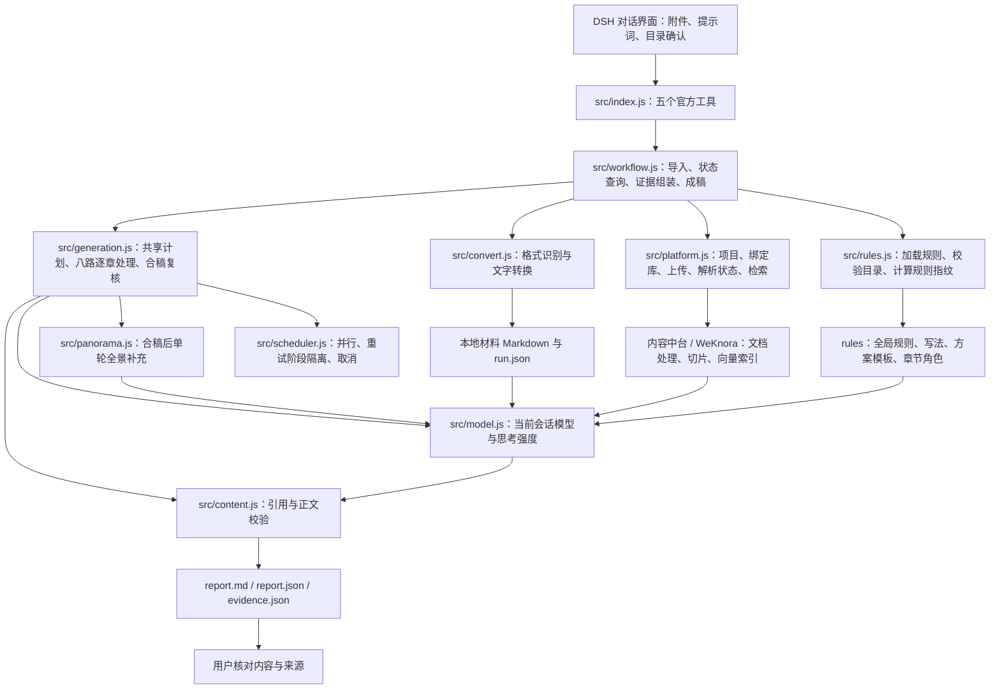

# DSH 材料与知识组装插件

基于 DSH/Cordis 的独立内容生成插件。把用户材料转为 Markdown，同步到指定项目的知识库，再结合本次材料、授权知识片段与章节规则生成可审阅的方案正文。

当前交付范围是**内容底稿**：`report.md`、`report.json`、`evidence.json` 和运行记录。HTML 编辑、全景图绘制、PPTX/PDF 导出留待后续实现。本项目不依赖旧售前插件、旧文案插件或 HTML Anything。

## 1. 先找到项目、插件和产物

| 对象 | 位置 / 标识 |
|---|---|
| GitHub 仓库 | <https://github.com/z460046000-ops/WLYD_content> |
| 本机开发目录 | `/Users/zhangzhengao/Documents/ChatGPT/WLYDContant/dsh-material-knowledge-assembly` |
| 插件 npm 包名 | `@wlyd/dsh-material-knowledge-assembly` |
| Cordis 组件 ID | `wlyd-material-knowledge-assembly` |
| DSH 插件页名称 | `material-knowledge-assembly` |
| 官方工具前缀 | `wlyd_assembly_` |
| 当前发布包 | `releases/wlyd-dsh-material-knowledge-assembly-0.2.4.tgz` |
| 发布包校验清单 | [releases/SHA256SUMS](releases/SHA256SUMS) |
| 本机 DSH 安装目录 | `~/.dsh/profiles/web/node_modules/@wlyd/dsh-material-knowledge-assembly/` |
| 运行产物 | **当前 DSH 会话工作区**下的 `artifacts/material-knowledge-assembly/runs/<runId>/` |

开发目录、安装目录和运行产物是三个位置。修改仓库源码后，要重新打包、安装并重启 DSH 才能让新版本生效。用户在 `gen` 工作区测试时，产物位于 `/Users/zhangzhengao/Desktop/gen/artifacts/material-knowledge-assembly/runs/`，不会自动写回本仓库。

## 2. 产品架构



### 各层负责什么

| 层 | 当前职责 | 主要文件 |
|---|---|---|
| 交互层 | DSH 通用对话界面；上传文件、提出目录调整、查看工具结果与报告 | 由 DSH 提供，目前没有独立业务前端 |
| 工具入口 | 声明参数、服务注入和执行入口，转换为标准 JSON Schema | `src/index.js`、`src/schema.js` |
| 流程编排 | 把读取、转换、目标选择、上传、检索、生成和检查串起来 | `src/workflow.js` |
| 材料适配 | 识别格式、提取文字、逐文件报告失败原因 | `src/convert.js` |
| 平台适配 | 配置账号登录、检查项目与绑定库、文件上传与知识检索 | `src/platform.js` |
| 规则层 | 加载模板和章节角色，校验目录，保存实际规则版本及哈希 | `src/rules.js`、`rules/` |
| 章节生成 | 共享关联计划、逐章取材写作、合稿复核 | `src/generation.js` |
| 全景补充 | 依据后文重点场景，单轮按需追加并保存原稿 | `src/panorama.js` |
| 模型与调度 | 默认八路、可配置额度、取消、模型路由和思考强度；每阶段限时 | `src/scheduler.js`、`src/model.js` |
| 内容检查 | 逐字引文、数字、章节与关系定位；Markdown 输出 | `src/content.js` |
| 产物层 | 保存输入材料、证据、待审正文、规则指纹及运行结果 | 会话工作区的 `artifacts/` |

后台负责已有文档的解析、切片、向量化和检索。插件当前在本地先把支持的文件转成 Markdown，再上传 Markdown；当前上传的不是原始 Office/PDF 文件。图片 OCR、DMG 解析等能力尚未接通。

## 3. 规则在哪里，分别管什么

```text
rules/
├── global.json                         全篇事实、取材、组稿和校验规则
├── style.json                          共用表达方式，不含产品事实
├── templates/
│   └── presales-solution.json           售前解决方案默认目录
└── chapters/
    ├── policy-trends.json               政策与趋势
    ├── business-challenges.json         业务分析：现状/挑战二选一
    ├── solution.json                    总体方案
    ├── business-architecture.json       业务架构全景的内容要求
    ├── product-architecture.json        产品功能全景的内容要求
    ├── scenario-solution.json           典型场景方案
    ├── technical-platform.json          技术平台
    ├── customer-cases.json              合作案例
    ├── company-profile.json             企业介绍
    └── delivery-service.json            可选的实施与服务章节
```

| 规则文件 / 字段 | 含义 | 修改时机 |
|---|---|---|
| [global.json](rules/global.json) | 全局证据要求、事实与假设的区别、组稿顺序、全篇检查 | 改所有方案共用的内容纪律时 |
| [style.json](rules/style.json) | 标题、句式、业务动作、能力与条件的表达方式 | 改共用写法时 |
| [presales-solution.json](rules/templates/presales-solution.json) | 某种方案的目录、章名、顺序、层级与必选性 | 改方案类型的默认结构时 |
| `chapters/*.json` 的 `extractQuestions` | 本章重点检索线索，**不是材料白名单** | 从 goodcase 归纳新的取材重点时 |
| `write` | 本章如何组织和撰写 | 改章节的表达任务时 |
| `validate` | 本章应满足的内容要求 | 增加具体审核条件时 |
| `missing` | 内容缺失时如何检索、给候选或追问 | 改缺失处理策略时 |
| `dependsOnRoles` | 章节的语义依赖说明 | 语义依赖由共享关联计划协调；当前不按此字段拓扑排序 |

规则读取自**已安装插件包**内的 `rules/`。修改本仓库规则后须发布并重新安装；目前没有平台在线规则编辑器，也没有自动把用户对话写回规则文件的功能。

共用写作规则现要求：正文尽量用简短小标题或短语概括论点，再用短句解释；从大段材料取材时先概括，不直接堆砌原文。事实、因果、条件和边界仍需写清，逐字引文仍需能在原始证据中定位。这是写法偏好，不强制每段套格式，也不裁剪送入模型的原始材料。

通用取材与撰写顺序定义在 `rules/global.json` v0.6.0 的 `extraction.workflow`，所有方案模板和章节共用：

1. **全局了解材料**：明确主题、读者和范围，盘点事实、能力、场景、问题与限制，形成各章取材方向。
2. **按章节定向混合检索**：结合本章目标和本次材料中的对象、业务术语构造查询；提取问题是重点提示，其他相关有价值材料同样保留。
3. **带上必要上下文**：保留命中片段所需的标题、前后文、条件及边界，并保留原文和来源定位；确有必要时才回读更完整原文。
4. **内容不足再补检索**：针对具体缺失调整查询或补查上下文；仍不足时明确标注待确认内容，确需用户事实时再追问，无关章节继续。

原始材料与证据完整留存，按章取材依据相关性和上下文完整性，不新增固定 token 裁剪上限。**0.2.4 安装包包含这套通用规则；当前程序仍先统一检索，再把同一份公共材料池传给各章。按章动态查询、上下文回读和缺失驱动的补检索尚未接入自动调度，不能认为写入规则就已经实现。** 已安装的旧包和运行中的浏览器插件不会自动更新。

规则来自完整 goodcase 的组织方法归纳，取样依据见 [docs/mvp-rule-evidence.md](docs/mvp-rule-evidence.md)。这是可审查的 MVP 规则配置，尚不是模型微调。goodcase 中的客户、能力、数字、奖项和承诺不会作为新报告的事实来源。

### 内容结构为什么可以变化

方案模板与章节规则分开：模板决定“有什么章节、怎么排序”；章节角色决定“这一章怎么提取、写作与检查”。

- `key`：项目目录中某个章节的稳定 ID，用来关联正文与跨章节关系。
- `title`：给读者看的标题，由 LLM 按章节含义生成自然近义表达，每次可变化，不固定抽签；不保证每次必定不同。
- `canonicalTitle`：保存改写前的目录标题，方便追溯；标题变化不改变 key、roleId、层级或规则。
- `roleId`：绑定章节规则。不同方案可以复用同一角色。
- `children`：子章节，当前目录最多三级。
- `required`：默认需要覆盖；资料不足时记录待补项，不代表强行编造正文。

当前默认六章：政策与趋势、业务分析（业务现状/需求挑战二选一）、解决方案、技术平台方案、可选合作案例、企业介绍。解决方案包含业务全景、产品功能全景和典型业务场景三个子节点。目前全景部分生成的是文字内容，不生成架构图。

“客户解决方案”应新增 `rules/templates/customer-solution.json`，使用用户提供的目录；可继续绑定已有角色，只有新的语义任务才新增章节角色。后续海报等产物也可复用材料、证据和规则基础，但还需新增内容模型及呈现适配器。

用户在 DSH 对话中要求增删、改名或排序时，先调用 `wlyd_assembly_outline` 预览，再把确认后的 `outline` 传给组稿。自定义 `roleId=custom` 须补 `goal`、`audience`、`questions`、`evidenceScope`、`acceptance`，不能只凭标题猜造提取规则。目前目录实例保存在生成产物中，尚无独立的目录版本审批界面。

### 写法、内容重点与标题变化

- `business_mode`：`current-state` 写运行流程、现有情况；`needs-challenges` 写问题、影响与诉求；`auto` 由共享规划依据材料与受众二选一，记录理由。近义标题仍需符合所选写法。
- `trend_framework`：`pest` 或 `management-business-technology`（管理、业务、技术），`auto` 让模型二选一。资料少时展开变化→业务影响→建设回应，不编造政策或统计。
- 业务分析占正文 **15–30%**；解决方案连同全部子章合计 **40–60%**，都是软目标。按非空白正文字符统计，不计标题、引用和审核清单；自定义目录缺少相关组时不强套比例。不达标进入 reviewItems，不靠重复凑数。
- 场景应说明触发、参与者、用户与系统动作、能力、输出、价值机制和边界。对外方案不能把厂商内部研发问题当客户痛点。
- 标题由共享规划统一改写，单章沿用同一版标题；非法、无据数字、混合写法或重复的变体回退默认标题，列入复核。语义是否贴切仍须人工核对。

### 两类全景图怎样生成内容

规则分别在 [business-architecture.json](rules/chapters/business-architecture.json) 与 [product-architecture.json](rules/chapters/product-architecture.json)。学习依据与执行细节见 [两类全景学习记录](docs/panorama-rule-evidence.md)。

- **业务架构全景**解释角色、业务运转及结果；**产品功能全景**解释模块怎样支撑业务及其边界。每个核心模块说明“对应问题→使用者与动作→支撑能力→产出及价值机制”。
- 先全量盘点，再按目标读者、核心问题、重点场景自选维度、分层和分组，保存选择理由。管理/执行/底座、用户层/应用层/能力层等都是参考，可组合、自建、合并或省略，不固定三层或五层。
- `plan.json` 的 `chapterGuidance[].organization` 保存 `purpose`、`scope`、`dimensions`、`reason`；维度缺失只提醒核对，不强行填模板。两图与场景共用已有问题、能力和场景 ID。
- 各章完成后，若已有全景章及场景章，用**一次** `panorama-enrichment` 请求检查实际后文，按需追加缺失上级节点、关键支撑或价值说明。充分覆盖可不追加；只补已有全景，原段落、目录与共享 ID 保持不变。过滤重复、越界或无效补充；失败保留原稿并提示核对，不循环重试。
- 全景段落附 `capabilityStatus`（existing/pilot/planned/proposed/unknown）和 `capabilityOwnership`（self/third-party/customer/unknown）；未知不会自动当自有或已具备。对规划、试点、第三方和客户已有能力给可读标记，拦截部分明确升级冲突；分类与语义仍需人工核对。
- 当前输出为全景**文字内容**，图形渲染、样式、HTML/PPTX/PDF 仍在后续范围。本次 PDF 和截图仅供离线提炼规则，未作为每次生成的产品事实或模型微调数据。

### 全篇如何保持前后关联

内部优先按 **有据产品能力 → 可落地业务场景 → 回应的问题 → 相关趋势** 反推组稿；读者仍按已确认目录阅读。

`report.json` 的 `assemblyLinks` 保存能力证据、场景段落、问题段落与趋势段落的建议关系。关系不足时先检索；仍不足则给明确标注为“待确认”的场景假设或建设方向，不把关系不足放入缺口来阻断报告。真实客户事实、已实现功能、正式政策和数字仍须证据。

`reviewItems` 记录需要人工核对的关系。机器可核对引用编号、逐字引文和部分数字；机器不能据此证明因果或语义关系一定成立。

## 4. 现在如何调度，未来怎样扩展

### 当前实现

DSH 对话中的 Agent 按用户指令调用工具；插件没有独立后台任务队列或定时调度器。

1. `projects`：确认配置账号可见的项目。
2. `outline`：加载模板并预览默认或修改后的目录。
3. `ingest`：读取文件/会话附件，逐文件转换；目标唯一时同步，否则返回选择项。
4. `status`：按需查询后台文档状态，包括 `finalizing`；没有后台自动轮询。
5. `generate`：收集证据→共享关联规划→**默认最多八条逐章提取、撰写、校验流水线**→按目录合稿→单轮按需补充全景→一致性复核→待人工确认。

检索请求另有最多四路额度；局部检索失败保留成功片段并记录覆盖。章节提取和撰写共用默认八个在途模型请求名额，同一进程中的多个生成运行也共享，不能叠加各次运行的额度。单章提取/撰写各最多尝试两次，失败后其他章节继续，所有阶段文件独立保存。取消时停止启动排队章，并向活动请求传递取消信号。

生成并发默认 8，可用进程环境变量或 `$DSH_HOME/.env` 的 `WLYD_ASSEMBLY_CONCURRENCY` 设置为 1–12；进程环境变量优先，非法值回退 8，改动后须重启 DSH。该设置同时作用于章节任务和共享模型请求，不改变检索四路额度。真实网关在不同并发下的耗时仍需复测。

本次材料的可读正文全部保留，按段送入模型；知识库先宽泛检索，再按章节查询，去重后保留命中正文。`extractQuestions` 只提供重点。插件不压缩 token 上下文，DSH 与模型服务仍有各自限制。每次模型请求最多等待 10 分钟（含排队）；会话的模型与 reasoningEffort 原样透传，由 DSH 校验支持性。run.json 记录每次请求阶段、输入字符规模、证据数、耗时边界与错误；字符数不等于 token 数。识别到上下文超限时不重复同一请求、不偷偷裁剪，返回阶段和输入规模，仍受平台真实上下文限制。

模型返回 JSON 时，仅尝试修复字符串内控制字符和结构性的尾随逗号；截断或其他无法确认的输出仍报错并按原流程处理。生成工具只返回 runId、章节/证据数量、失败章节、审核项数量和报告路径；完整进度保存在 run.json，可用 status 查询。

### 后续调度设计（尚未实现）

下一步按 [后续待办](docs/backlog.md) 校准内容质量、接入统一多来源检索，再做逐章对话修改与版本恢复。共享规划、默认八路逐章生成和合稿复核已实现；确认后的呈现适配器仍待后续。

单章任务应保存输入版本、规则指纹、证据和结果；用户扩写、缩写或重写某章时，只重算该章及受影响章节。`dependsOnRoles` 可用于依赖调度，但共享的能力与问题关系需要先固定版本，防止章节并行生成后相互矛盾。

当前队列、局部重试、并发额度和取消属于进程内能力；落盘记录不等于重启后自动恢复。持久任务、断点续跑、单章编辑版本、目录版本和多人审批仍应对接平台能力。

## 5. 五个官方工具

| 工具 | 主要输入 | 输出 / 用途 |
|---|---|---|
| `wlyd_assembly_projects` | 无 | 当前平台配置账号可见的项目 |
| `wlyd_assembly_outline` | `template_id`、可选 `outline`、`business_mode`、`trend_framework` | 目录预览与规则指纹 |
| `wlyd_assembly_ingest` | `files` 或 `attachment_refs`，可选项目/库 ID | 导入 `runId`、逐文件转换与同步状态 |
| `wlyd_assembly_status` | 导入或生成的 `run_id` | 查询解析或逐章进度；导入状态未变时不重写文件，生成查询始终只读 |
| `wlyd_assembly_generate` | `source_run_id`、可选 `project_id`、模板、目录、读者、两个模式参数 | 生成 `runId`、报告与证据路径 |

会话附件只接受当前会话用户真实上传的引用；附件 ID、文件名和字节数必须匹配。DSH 的完整 ID 通常以 `sha256:` 开头；模型省略前缀时仍须匹配会话里已有的同一附件，读取时使用平台保存的真实引用。

项目与绑定知识库必须同时在当前配置账号的可见范围内。重复材料按目标库返回的 `file_hash`（MD5）与大小匹配并复用文档 ID，避免重复上传；此 MD5 仅用于对接后台去重字段，本地来源追踪另存 SHA-256。没有匹配时走真实上传，不能把 HTTP 500 当成功。

## 6. 安装和开始使用

需要 Node.js 22+、DSH，以及内容中台配置账号。

```bash
# 安装到指定 DSH profile；请将路径换成下载包的绝对路径
dsh plugin --profile web add /absolute/path/to/wlyd-dsh-material-knowledge-assembly-0.2.4.tgz

dsh --profile web --dump-config
```

安装后重启对应 DSH 服务，在插件页核对 `material-knowledge-assembly` 版本与组件“运行中”。同机可能安装多个历史插件；本项目的验收只以 `wlyd_assembly_*` 工具为准。

配置项可放插件 config、环境变量或 `$DSH_HOME/.env`，优先级依次为插件 config → 环境变量 → `.env`：

| 插件 config | 环境变量 | 说明 |
|---|---|---|
| `baseUrl` | `WLYD_PLATFORM_BASE_URL` | 内容中台 HTTPS 地址；本机测试可用 `http://127.0.0.1:<port>` |
| `email` | `WLYD_PLATFORM_EMAIL` | 配置账号 |
| `password` | `WLYD_PLATFORM_PASSWORD` | 配置账号密码 |
| `tenantId` | `WLYD_PLATFORM_TENANT_ID` | 目标租户；登录返回租户须一致 |

凭证不要写入仓库或报告。DSH 用户与配置账号的身份映射尚未正式打通，`platformUserId` 保持空；不能声称后台已按真实平台用户归属上传。

### 可直接使用的提示词

**第一步：导入与预览目录**

> 请只使用 wlyd_assembly_* 工具。把我上传的材料转成 Markdown，列出可访问项目，并让我选择同步目标；若目标唯一就同步。再预览“产品售前解决方案”目录，告诉我每份文件的转换与后台状态。

**第二步：生成底稿**

> 我确认这个目录和项目。请用刚才导入的 runId、该项目知识库和 presales-solution 模板生成方案，读者是企业业务负责人。优先按产品能力→场景→问题→趋势关联组稿，缺关系时给明确标注的待确认候选。请返回真实报告和证据路径；工具失败时直接说明原因。

**第三步：调整内容结构**

> 在当前目录增加“实施与服务”，绑定 delivery-service 角色，放在技术平台之后。先展示调整后的目录，等我确认后再生成。

当前增删章节可通过目录预览实现；逐章对话扩写/缩写尚未作为独立工具接入，不能承诺只修改某章而其余章节完全不变。

## 7. 运行产物和状态怎么看

```text
<会话工作区>/artifacts/material-knowledge-assembly/runs/<runId>/
├── run.json            该次导入/生成的状态、来源 run、项目与身份信息
├── materials/*.md      仅导入运行：逐文件转换出的材料
├── evidence.json       仅生成运行：本地/知识库证据、检索覆盖与输入缺口
├── plan.json           共享关联计划、全景动态维度及理由、模式、标题、规则指纹
├── chapters/<key>/     extraction.json、draft.json、chapter.json 或 error.json
│                       全景有效追加后另存 enriched.json，原 chapter.json 保留
├── panorama-enrichment.json  单轮全景补充的建议、过滤、追加结果和覆盖提示
├── consistency-review.json  合稿模型复核成功时保存的待核对项
├── report.json         schemaVersion=2：目录、正文、模式、篇幅、引用与待核对项
└── report.md           生成成功后：供用户阅读的正文
```

导入与生成有不同 `runId`；生成记录用 `sourceRunId` 指向材料导入记录。`loadedRules` 保存各规则文件的版本和 SHA-256，`ruleFingerprint` 保存组合指纹，便于回查“这一稿用了哪套规则”。

| 状态 | 实际含义 |
|---|---|
| 文件 `converted` | 本地 Markdown 已生成，不代表后台解析完成 |
| 文件 `needs_ocr` / `unsupported` / `failed` | 需要额外能力或当前材料不可读，原因逐文件保留 |
| `needs_project_selection` / `needs_knowledge_base_selection` | 需选择目标，不会擅自选库 |
| `local_only` | 已有本地材料，平台未配置/不可用或没有目标；可继续本地组稿 |
| 文件 `uploadDisposition=reused` | 已复用目标库内相同摘要和大小的文档 |
| 文件 `pending` / `processing` / `finalizing` | 后台仍在处理，须再次查询 |
| 文件 `completed` | 后台解析完成，可作为知识检索候选 |
| 文件/导入 `upload_failed` | 上传失败；`status` 不会自动重传，但本地材料仍可使用 |
| 导入 `uploaded_or_pending` | 至少有材料已提交或复用，具体结果仍看逐文件状态 |
| 生成 `collecting_evidence` / `planning` / `generating` / `enriching_panoramas` / `reviewing` | 收集证据、规划、逐章处理、单轮全景补充、合稿复核；chapters 与 panoramaEnrichment 提供进度 |
| 生成 `cancelled` | 已取消，已完成的章节文件保留；尚无自动恢复工具 |
| 生成 `needs_human_review` | 生成调用结束并落盘，仍须核对正文、引用与缺章；不等于六章全部合格 |
| 生成 `failed` | 未完成成稿，查看 `run.json.error`；不能把中间证据文件当报告 |

机器会过滤无效引文、无据数字和不合格段落，因此最终稿可能有缺章或待补项。引用可逐字定位也不等于事实含义已核实，用户仍需核对语义和对外使用范围。

## 8. 支持范围与实际限制

| 输入 / 功能 | 当前行为 |
|---|---|
| UTF-8 文本、Markdown | 提取正文；大量控制字符的伪文本文件拒绝 |
| DOCX、文字 PDF、PPTX、XLSX | 提取可读文字；不保证图表、版式、图片文字完整 |
| ZIP | 逐条转换支持格式；有展开量与条目数保护 |
| 图片、扫描 PDF | 返回 `needs_ocr`，未接 OCR |
| DMG、旧 Office、音视频、链接抓取 | 尚未实现，不能宣称“任意文件都可解析” |
| 文件限额 | 每批 100 个、单文件 500 MB；ZIP 最多 1000 条、展开共 1 GB |
| 500 MB 实测 | 入口限额已放宽；只完成 25 MB 文本抽查，尚未证明任意格式的 500 MB 全链路可用 |
| 知识检索 | 新 retrieval/query 尚未接入，当前仍使用 hybrid-search；只检索当前账号可见且绑定目标项目的完成文档；每次后端查询请求最多 50 条，命中结果不在插件里裁短 |
| 公开资料检索 | 尚未接入，不能把模型生成的政策当公开检索结果 |
| 内容编辑 | 目录调整可用；专用章节编辑界面、章节版本与确认状态机尚未实现 |
| 展示与导出 | 当前为 Markdown/JSON；HTML、架构图、PPTX/PDF 尚未实现 |

2026-10-15 的旧版 `0.1.7/0.1.8` 浏览器已实际调用官方工具生成一份待审报告：8 个章节节点、56 条输入证据，保留的 20 处引用均能逐字定位。该次报告的跨章节关联记录未通过校验，且原材料为内部项目资料，正文包含内部研发与商业判断，**不能直接当作对外售前成稿**。这证明旧版真实生成入口可用。`0.2.1` 已用本机浏览器和中台 CallWan 知识库重跑：报告虽落盘，但生成工具返回被 DSH 拒绝，且 9 个章节节点有 3 个失败；详见测试记录，尚未通过完整对客方案验收。

最新真实浏览器验收、报告质量与未打通项见 [docs/test-record.md](docs/test-record.md)。本机环境、后端状态和模型路由会变化，单元测试通过不能代替真实浏览器结果。

## 9. 开发、验证与交付

```bash
npm ci
npm run check
npm test
npm pack --pack-destination releases

# 在 releases 目录执行
shasum -a 256 -c SHA256SUMS
```

交付前检查：包白名单只含源码、规则、文档和 Cordis 清单；不包含凭证、goodcase 原件、用户材料、运行报告或旧插件源码。每次改规则应更新相应 `version`，改执行逻辑则更新包版本，重新生成测试记录与安装包哈希。

更多资料：

- [后续待办与统一检索接入计划](docs/backlog.md)
- [外部审阅逐项处理](docs/review-fixes-20261015.md)
- [架构与调度边界](docs/architecture.md)
- [goodcase 取样与 MVP 规则依据](docs/mvp-rule-evidence.md)
- [可复用能力与旧规则隔离](docs/reuse-audit.md)
- [测试记录与真实未打通项](docs/test-record.md)
- [项目记忆](memory.md)
