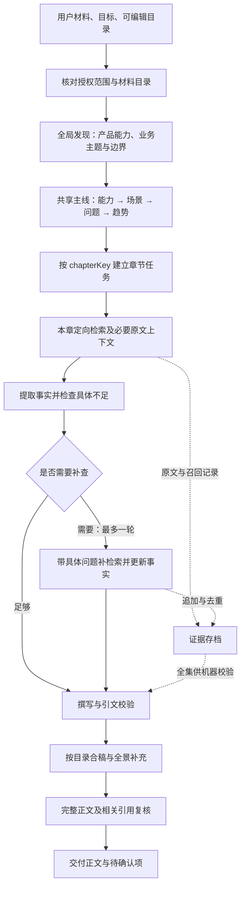

# 按章节取证与生成耗时优化规划

日期：2026-10-15。状态：待用户确认，尚未修改运行代码。

核对基线：仓库 `0.2.4 / 2cf480e`，global 规则 `0.6.0`；默认模型并发 8、检索并发 4。当前规则已定义“四步取材”，程序尚未执行逐章定向检索。

## 1. 这次解决什么

把“生成前统一检索，所有阶段反复接收全部证据”改成“先了解材料和建立主线，再为每章取证，缺什么补什么”。目标是减少无关输入、超时和无效重试，同时保持内容完整、前后对应、来源可查。

完整原始材料与已召回证据继续存档；每次模型调用选择相关原文及必要上下文。`extractQuestions` 仍是重点提示，不是取材白名单。方案模板、可编辑目录、业务现状/需求挑战二选一、趋势框架二选一，以及业务分析 15–30%、解决方案 40–60% 的软目标继续有效。

首期范围：逐章检索、本地材料取材、必要上下文、有限补检索、各模型阶段输入分配、计时和失败可见性。八路模型与四路检索继续独立调度。思考强度降档、并发调参、提取与撰写合并分别留作后续有明确假设的验证。

## 2. 当前证据支持哪些结论

### 本机可核对的原始记录

历史 CallWan 运行 `49409082-53b6-4fc6-b45d-3623cf45d184`，旧版 0.2.1、四路并发、DeepSeek 路由：

| 环节 | 经过时间 | 说明 |
| --- | ---: | --- |
| 开始到规划前 | 6.4 秒 | 含准备、材料读取与检索，不能全部算作检索 |
| 共享规划 | 331.7 秒 | 1 次请求，输入 72,187 |
| 各章提取与撰写 | 1,448.9 秒 | 并行阶段约 24 分 9 秒；27 次请求，含重试 |
| 全景补充 | 80.3 秒 | 输入 117,608 |
| 最终复核 | 162.5 秒 | 输入 123,086 |
| 整体 | **2,029.8 秒** | **约 33 分 50 秒；9 个节点仅 6 个完成** |

输入数字沿用代码 `JSON.stringify(prompt).length`，单位是 UTF-16 代码单元，不是字节或 token。30 次请求合计输入 2,599,355。77 条原始证据约 113,622 UTF-8 字节；这批证据被反复装入请求。该运行证明重复输入确实存在，不能单独证明耗时都由输入造成，也不能直接用于比较新版八路的收益。

### 两份外部耗时报告的使用边界

- R2 附件：记录 0.2.3、52 条证据、规划 600 秒超时，运行 `be1a3839-0efc-4258-8240-49b28d88f231` 当时仍在进行。本轮未在已检查的本机运行目录找到其原始记录；“15–20 分钟”“减少 75%”属于预测。
- 2026-10-13 对比：旧插件 DSH 约 23 分 56 秒、后端约 113 秒，但模型、章节结构、知识库绑定、生成与校验流程均不同。部分父子阶段时间重叠，不能相加；也不能据此推断迁到后端即可获得同等提速。

### R2 建议中需要修正的地方

| 建议 | 本次处理 |
| --- | --- |
| 按召回问题标记证据归属 | 采用，但显式记录 `queryId/chapterKey/roleId/purpose`；问题去重后不能靠数组下标反推章节 |
| 所有全局命中加入每章 | 改为只加入本章需要的共享能力、问题和场景证据，避免再次接近全集 |
| 取前 200 字供规划 | 不作为事实证据；截头可能丢掉条件、否定或状态。规划使用材料目录、主题线索与有代表性的完整原文片段 |
| 最终复核无需改变 | 当前复核也带着全部证据，必须一起分配输入 |
| 空切片让模型自行复查 | 当前模型调用没有检索工具，必须由程序实际执行补检索 |
| 引文校验兜底漏材料 | 引文正确只能证明文字可定位，不能证明重要材料没漏、语义没变 |
| 按字符伸缩超时 | 附件公式在 750 字符时就封顶 15 分钟；不采用。分开排队与执行计时，再设有界阶段配置 |
| 规划“静默”降级 | 当前已有失败记录和 reviewItems，但摘要不够明显；需显式报告规划成功或降级 |
| 八路耗时差异证明限流 | 仅能作为线索；需排除输入、输出、思考、重试与本地排队差异 |

## 3. 后端、插件与 DSH 各负责什么

| 组件 | 本次职责与可用能力 | 需要核实的边界 |
| --- | --- | --- |
| 内容中台 | 解析、分块、向量/关键词混合检索、排序与来源定位 | 能力总览描述了分片列表/详情，但缺少可直接接入的父块、邻块回读接口契约 |
| 统一检索接口 | `/api/v1/knowledge-bases/{id}/retrieval/query`；按文档过滤，返回 hybrid 原文块、Wiki、图谱及局部状态 | 首期优先 hybrid。Wiki/图谱的文档过滤与来源回读未验收；图谱目前是库级读取，不按问题过滤 |
| 独立插件 | 根据目录和规则生成问题、选择证据、补查、写作、关联、校验与存档 | 不另建向量库；不依赖旧插件或 HTML Anything |
| DSH | 提供模型、并发请求的执行环境、流式事件与可选 usage | 源码支持每次请求指定 reasoningEffort，但具体模型可用值与网关效果需实测 |

统一接口的 `knowledge_ids: []` 表示不限制，不能用它表示“没有可用文档”。必须先校验项目及知识库访问范围，限定解析完成的文档；没有可用文档时跳过该库。HTTP 200 仍可能有来源失败，要记录每个来源状态、`partial` 和 `trace_id`。

先在检索适配层归一化新旧接口；新接口合同验证通过后切到 hybrid。若部署尚未提供该路由，可明确记录后使用现有 hybrid-search；401/403 不通过换接口绕过。Wiki、图谱后续接入，不阻挡逐章取证实施。

## 4. 目标流程与文件分工

章节任务最多 8 路；其中后台检索请求共享 4 个名额，模型请求共享 8 个名额。某章拿到证据后即可继续提取、写作，不必等其他章节全部完成检索。全局准备与共享规划仍是前置步骤。

| 文件或模块 | 拟变更职责 |
| --- | --- |
| `src/retrieval.js`（新增） | 查询描述、运行内证据登记与去重、按章选择、补查、必要上下文及覆盖记录 |
| `src/platform.js` | 新旧检索接口适配，保留授权、文档过滤及局部失败信息 |
| `src/workflow.js` | 准备授权范围和本地材料，将检索能力交给章节调度，持续保存新增证据 |
| `src/generation.js` | 规划、逐章提取/撰写、补查、复核分别组装输入；记录规划降级与章节状态 |
| `src/panorama.js` | 仅接收全景与场景相关证据，保留现有追加式补充和能力边界校验 |
| `src/model.js` | 按实际请求计时，采集 usage，区分排队与执行超时，保持取消传递 |
| `src/content.js` | 仅在适配来源索引需要时修改；引文与数字校验仍基于原始证据 |
| `rules/global.json` | 将已定义的四步规则与实际调度对齐；模板及章节规则仅按接口需要调整 |
| `test/*.test.mjs`、`package.json` | 覆盖新行为；替换“每阶段必须携带全集”的旧断言，检查新增模块 |
| `README.md`、`docs/architecture.md`、`docs/test-record.md`、`memory.md` | 实施后说明规则、调度、证据位置、安装与实测边界 |

DSH 宿主源码先作为能力依据，本轮计划以插件内改造为主。若发现会话当前模型与插件实际读取模型不一致，先核实宿主接口并修正取值或明确标记，不能让测试暗中换模型。

拟新增 `retrieval.json` 保存查询、来源状态及选择原因；完整原文仍进 `evidence.json`，逐章选择放在 `chapters/<key>/retrieval.json`。`run.json` 保留摘要与进度，避免把全文再次带回 DSH 对话。原有产物采用增量字段兼容，读取旧运行不能要求新字段必填。

## 5. 六个实施步骤及验证

| 步骤 | 实施内容 | 怎么验证 |
| --- | --- | --- |
| 1. 补齐计时，固定基线 | 记录入队、实际发起、首个 reasoning/text 事件、首个正文、结束、错误及重试原因；记录实际 provider/model/effort、输入字符与字节、usage（可得时） | 用可控流事件验证排队与执行时长分开；usage 缺失标未知；基线固定材料、目录、受众、规则、模型与并发 |
| 2. 拆出检索与证据登记 | 显式查询归属；同一证据合并多个召回原因；稳定 ID；授权文档范围准备一次；新增证据串行落盘 | 不同完成顺序仍得到同一来源 ID；同 chunk 在不同库/文档不碰撞；重复召回不丢归属；取消后已完成记录可读 |
| 3. 接通全局发现与逐章取证 | 全局阶段取材料目录、主题及代表原文形成主线；章节查询由目标、受众、角色规则、规划重点和本次术语共同形成；本地材料同步按章选择 | 自定义章节、同角色多章、改名换序均按 key 分配；有价值但不在 extractQuestions 中的材料仍能进入；无关章节输入减少 |
| 4. 补上下文与具体缺项 | 保留条件、否定、单位、状态和归属；有可靠接口才回读父/邻块；提取后最多一轮补查并更新事实，不原样重复问题 | 补查确实发起后台请求并形成新原文；否定与条件不丢；零命中/局部失败能继续其他章，缺事实不伪造 |
| 5. 覆盖全部生成阶段 | 规划、提取、撰写、全景补充、最终复核各用相应证据；规划降级进入工具摘要；分阶段超时配置且区分队列与执行 | 实际请求指标等于实际输入；复核不再带未使用的知识库全集；引用仍能回到完整存档；8/4 名额与取消有效 |
| 6. 同条件验收，再发布 | 固定材料回放与真实 CallWan 运行；人工检查重点章节、关联与遗漏；更新文档、打包、安装验证及 SHA-256 | `npm run check`、`npm test`、`git diff --check`；记录真实阶段耗时/输入/完整率；用户确认实施后再进入交付流程 |

### 实施时必须守住的细节

- **共享主线不散**：所有章节共用经过证据核对的能力、场景、问题与趋势 ID；每章携带所引用主线的原文依据。章节并发过程中不互相改共享计划。新发现的相关事实保留，并列出需合稿复核的关联补充，不能因计划未覆盖而丢弃。
- **按章节实例取材**：`roleId` 决定规则，`chapterKey` 决定本次章节；不能把不同场景章仅因同一角色合成一个切片。公共查询去重后，保留全部使用它的章节。
- **全局发现覆盖材料范围**：使用可见文档目录、标题/章节与主题线索组织发现查询，兼顾不同材料；这些线索只导航，不替代事实来源。全局证据不足时先定向补查能力边界，不把前 200 字当概括结论。
- **本地材料也要分配**：已入库且可检索的材料复用后台能力；仅本地材料可用时按文档结构、主题线索及原文段落选择，保持相邻段落可回读。无需新增本地向量服务，也不能继续把本地全集塞进每章。局部词面未命中不等于无价值，需通过全局主题及覆盖检查发现遗漏。
- **补查有限且有目的**：初次提取返回具体欠缺问题；程序执行一轮补查并刷新提取结果，记录追加调用。仍缺事实时给出明确的待确认候选或事实缺失说明，继续完成其他内容。公开检索能力当前未接，本期不假称自动上网查证。
- **原文与摘要分离**：概括可供组织内容；事实引文必须指向完整原文。原文上下文不足时补取，不靠模型生成“原文”。后台回读契约未确认时，使用已返回完整块及定向搜索，记录仍缺的上下文。
- **共享内容有选择**：仅加入当前章真正依赖的能力和关联事实；不能把“全局命中”当作每章必带集合。章节提取与写作共享该章证据，补查后同步更新。
- **后续两阶段也控制输入**：全景补充使用相关正文与证据；最终复核使用完整合稿、主线和实际引用的原文块及必要上下文。若仍大到超限，按章做语义复核、再做跨章关联复核，不静默截断正文。
- **并发安全**：来源 ID 由稳定来源定位决定，含知识库、文档、块及内容版本信息；不同检索结果完成顺序不改变引用。新增原文与审计记录串行保存快照，避免某章覆盖其他章刚写入的证据。缓存限定本次运行与授权范围。

## 6. 怎么判断确实变好了

先以固定材料做输入分配回放，检查重点来源被分到正确章节；再做同条件生成对照，最后在真实 DSH 浏览器跑一次完整 CallWan 流程。材料内容、目录、受众、模型与 effort、规则、并发必须记录并对齐；检索结果变化单独标注。

首期验收目标：

1. 选定的 CallWan 对照样本中，提取/撰写输入的中位数较同条件全集输入减少 **至少 50%**，作为目标而非预先承诺；各章实际输入和全链路总输入同时报告，不能靠大量追加调用掩盖成本。
2. 总经过时间、排队时间、模型执行时间、补查与重试成本分开报告；章节以中位数和最长耗时定位拖尾。少量样本不宣称稳定提速比例。
3. 要求完成的章节全部产出，规划成功或降级明确可见；失败、取消、上下文超限不能冒充完成。必要的待人工确认仍保留。
4. 引文定位、数字与来源权限检查通过；人工核对业务分析和场景深度、两类全景职责、能力状态、前后对应及关键材料遗漏。不能仅比较 reviewItems 数量判断质量。
5. 自定义目录、本地材料、单章零命中、来源局部失败、补查、取消均有最小回归；当前 35 项测试中依赖“全集输入”的断言调整为“完整存档、相关调用”。

不为补齐表格穷举实验。若上述验证已解决问题，即进入发布；若仍有明确瓶颈，再选一项验证：

| 后续措施 | 何时值得做 | 判断依据 |
| --- | --- | --- |
| plan/extract 降低思考强度 | 指定模型支持，且思考耗时仍明显 | 固定材料比较关键事实、边界、关联及耗时；不只看引文合法性 |
| 8 路与 6 路比较 | 排队/实际服务时长表明可能有并发争用 | 同输入输出规模和路由比较整体完成时间；不直接按一次方差改默认 |
| 合并提取与撰写 | 输入分配完成后，重复两阶段调用仍是主要成本 | 单独验证事实提取和正文质量；不能承诺合并后必然不超时 |

## 7. 待联调事项与本轮交付

待联调：统一接口真实 hybrid 响应及过滤、父块/邻块原文读取契约、当前模型 effort/usage 支持、DSH 会话所选模型与插件实际模型一致性。配置账号与 DSH 用户身份映射仍未打通；本期保持既有授权范围，不把它写成已解决。

R2 新运行的最终 `run.json` 尚未取得。实施可以先基于现有记录与固定材料推进，最终收益应使用相同版本和配置的新对照记录验收。

本轮仅新增此规划、追加 `memory.md`，核对本地代码、接口说明与已有运行记录。未调用后台或模型、未重跑浏览器生成、未修改运行代码、未发版推送。依据用户提供的 AGENTS 工作规则，确认首期范围后再实施。

### 核对来源

- [R2 建议](</Users/zhangzhengao/Downloads/WLYD_content-生成耗时优化建议R2-证据分治-20261015.md>)。
- [后端能力总览](</Users/zhangzhengao/Desktop/WLYD/后端/后端能力总览.md>)、[统一检索说明](</Users/zhangzhengao/Downloads/统一知识库检索接口使用说明.md>)。
- [旧生成耗时对比](</Users/zhangzhengao/Downloads/生成链路提速实测对比-后端生成vsDSH前端-20261013.md>)、[本机历史 run.json](</Users/zhangzhengao/Desktop/gen/artifacts/material-knowledge-assembly/runs/49409082-53b6-4fc6-b45d-3623cf45d184/run.json>)。
- 插件：[检索调度](../src/workflow.js)、[模型入参](../src/generation.js)、[模型调用](../src/model.js)、[全景补充](../src/panorama.js)、[接口适配](../src/platform.js)。
- DSH：[请求与流事件类型](</Users/zhangzhengao/Documents/WLYD/Deepseek harness/packages/llm/llm/src/types.ts>)、[模型能力校验](</Users/zhangzhengao/Documents/WLYD/Deepseek harness/packages/llm/llm/src/index.ts>)、[DeepSeek 协议序列化](</Users/zhangzhengao/Documents/WLYD/Deepseek harness/packages/llm/llm-deepseek/src/protocols/chat-completions/serialize.ts>)。以已读取的本机源码为依据，不等同于所有网关均支持对应参数。
